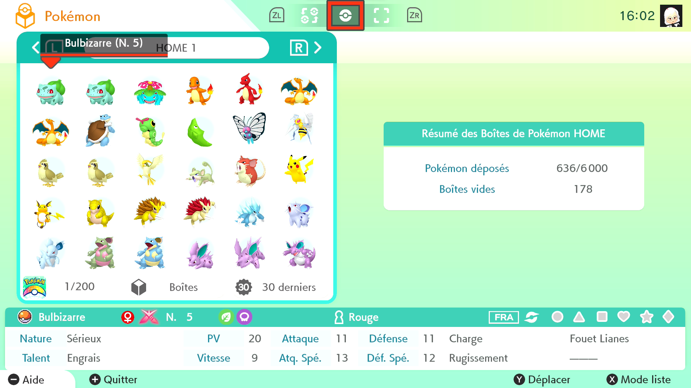

# Pokémon HOME - Box Sorter

---
## Program Description

Sort a consecutive range of Pokémon HOME boxes using rules such as National Dex number, level, or shininess. The program reads each occupied slot's summary, sorts the Pokémon across the selected boxes, and collects empty slots at the end.

---
## Instructions

**Switch Settings**

1. Set the screen size to 100% in the Switch settings.
2. [Switch 2 users must disable HDR.](../NintendoSwitch/Switch2Notes.md#switch-2-hdr-may-be-problematic)

**Program Settings**

1. Use a video resolution of 720p or higher.
2. Use a controller with Wired or Wireless performance class.

### Before You Start

1. Open your Pokémon HOME boxes and go to the first box you want to sort.
2. Set **Home Language** to the language used in the app and choose your **Sort Order Rules**.
3. Start with one box and **Dry Run** enabled. Check the JSON output and adjust the delays if the program has trouble navigating or reading summaries.
4. Return to your starting box, set the full box count, turn off **Dry Run**, and start the program.

!!! tip "Sorting a living dex"
    Use [Box Sorter Living Dex](BoxSorterLivingDex.md) to place Pokémon into a template with reserved slots for missing species and forms.

---
## Options

### Box Settings

#### Number of Boxes to Sort

Choose 1 to 300 consecutive boxes, starting with the current box and moving to the right. The default is 1. Include only boxes available in your HOME account that you want to rearrange.

#### Home Language

Select the language of the Pokémon HOME interface. The program uses this setting to read Nature and Ability on the summary screen. **Language of Origin** in the sort table uses the individual Pokémon's language tag.

### Timing

#### Capture Card Delay

How long the program waits for the capture card feed to catch up after an input. The default is 400 ms. Increase it if the video feed lags behind the program's inputs.

#### Pokémon Home App Delay

How long the program allows HOME to respond to controller inputs during navigation and sorting. The default is 240 ms. Increase it if HOME misses inputs or moves lag behind the program.

### Sorting and Output

#### Sort Order Rules

Add at least one rule. The program applies the rows from top to bottom, using each later rule to break ties. For example, with **Dex Number** above **Shiny**, shiny Bulbasaur come before non-shiny Bulbasaur, and both come before Ivysaur. Check **Reverse** on a row to reverse that rule's order. Any ties left after the last rule are sorted by National Dex number.

| Rule | Default order |
| --- | --- |
| Dex Number | Lowest National Dex number first. |
| Level | Lowest level first. |
| Shiny | Shiny Pokémon first. |
| Gigantamax | Pokémon with the Gigantamax mark first. |
| Alpha | Alpha Pokémon first. |
| Ball Type | Alphabetical by Poké Ball name. |
| Gender (Male, Female, Genderless) | Male, then female, then genderless. |
| Nature | Alphabetical by nature. |
| Ability | Alphabetical by ability. |
| Origin Mark | Groups Pokémon by their origin mark. |
| Language of Origin | Groups Pokémon by their language tag. |

#### Output File

Set the base name for the JSON exports. The default, `box_order`, produces `box_order.json` for the scanned layout and `box_order-sorted.json` for the planned layout.

#### Dry Run

Scan the boxes and write both JSON files while leaving the Pokémon in place.

#### Notifications

Configure the notification sent when the program finishes.

---
## Credits

- **Author** Prismillon
- **Maintainer** dolphincurry/Dalton-V

**Discord Server**

