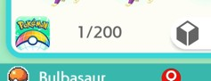

# Pokémon HOME - Box Sorter Living Dex

---

## Program Description

Arrange Pokémon in HOME according to a living dex template. The program scans both the living dex boxes and a separate range of reject boxes for matches. Missing Pokémon leave empty slots in the template. Duplicates and other Pokémon that do not fit the template go to the reject boxes as space allows.

---

## Instructions

**Switch Settings**

1. Set the screen size to 100% in the Switch settings.
2. [Switch 2 users must disable HDR.](../NintendoSwitch/Switch2Notes.md#switch-2-hdr-may-be-problematic)

**Program Settings**

1. Use a video resolution of 1080p or higher.
2. Use a controller with Wired or Wireless performance class.

### Before You Start

1. Choose a [Living Dex Style](#living-dex-styles) and set **Living Dex Starting Box**. The template determines how many consecutive boxes the living dex takes up.
2. Set **Reject Box Range Start** and **Reject Box Range End**. Use a separate range with enough empty slots for duplicates and Pokémon excluded by the template or filters.
3. Open your HOME boxes and go to **Living Dex Starting Box**. Use the box number shown at the bottom left of the screen.
4. Run with **Dry Run** enabled to review the planned layout. Return to **Living Dex Starting Box** before starting the run that moves your Pokémon.

!!! warning "Leave space in the reject boxes"
If the reject boxes fill, the program can temporarily move extras into empty slots later in the living dex. It stops if it runs out of space while clearing a template slot, so a live run may already have moved some Pokémon. Use a dry run to check space before sorting.

---

## Options

### Box Settings

#### Living Dex Starting Box

The HOME box number where the first template slot goes.

#### Reject Box Range Start

The first box to scan for additional matches and use for duplicates and overflow.

#### Reject Box Range End

The last box in the reject range, inclusive. Use an end number at least as high as the start. Keep the whole range outside the living dex boxes.

#### Living Dex Style

Choose the template that defines the order and positions of the Pokémon. The default is **Sorted by Forms**. See [Living Dex Styles](#living-dex-styles) for the layouts and box counts.

#### Custom Living Dex File

This field appears when you choose **Custom**. Select a JSON template in the format described under [Custom templates](#custom-templates).

### Dex Filters

#### Shiny Dex

Enable this to fill the living dex with shiny Pokémon only. With this setting off, the program fills the living dex with non-shiny Pokémon only.

#### OT Name Language

Choose the language used for the Original Trainer (OT) name you want to match. Choose **None** to accept any OT.

#### OT Name Filter

When an **OT Name Language** is selected, enter the exact trainer name you want to keep. The sorter uses the name it reads from the summary screen to decide which Pokémon can fill the template.

### Timing and Output

#### Capture Card Delay

How long the program waits for the capture card feed to catch up after an input. The default is 400 ms.

#### Pokémon Home App Delay

How long the program allows HOME to respond to controller inputs. The default is 240 ms. If you have already tuned either delay in [Box Sorter](BoxSorter.md), use those values here too.

#### Output File

The panel shows this field with the default `living_dex_order`. This version always uses the fixed filenames listed under **Dry Run** for its exports.

#### Dry Run

Scan and plan the sort while leaving the Pokémon in place. The program writes four JSON files.

| Boxes      | Scanned layout               | Planned layout             |
| ---------- | ---------------------------- | -------------------------- |
| Living dex | `living_boxes_unsorted.json` | `living_boxes_sorted.json` |
| Reject     | `reject_boxes_unsorted.json` | `reject_boxes_sorted.json` |

#### Notifications

Configure the notification sent when the program finishes.

---

## Living Dex Styles

The box counts below come from the templates bundled with the program, including any reserved empty slots. Set aside reject boxes separately.

### Standard layouts

| Style             | Boxes | Layout                                                                |
| ----------------- | ----: | --------------------------------------------------------------------- |
| Sorted by Forms   |    48 | National Dex order with alternate forms next to their species.        |
| Sorted by Species |    48 | National Dex order for the main species, followed by alternate forms. |

### Austin John Plays layouts

These templates follow the layouts in the [Austin John Plays Living Dex spreadsheet](https://docs.google.com/spreadsheets/d/16p2KitTbawEUCfbWVOT2FuN9qZO7rA1K6R01ccpR5yA/edit?gid=1493571483#gid=1493571483).

| Style                | Boxes | Layout                                                                                                                            |
| -------------------- | ----: | --------------------------------------------------------------------------------------------------------------------------------- |
| AJP Final Form       |    23 | Fully evolved species and their regional forms.                                                                                   |
| AJP Final Form Form  |    28 | Fully evolved species and their regional forms, with additional forms such as Unown letters and Deoxys formes.                    |
| AJP Living           |    40 | A species collection that includes earlier evolutions and regional forms.                                                         |
| AJP Living Form      |    51 | A species collection with earlier evolutions, regional forms, alternate forms, and separate slots for visible gender differences. |
| AJP Living Form Lite |    47 | A species and form collection with one slot for each visually distinct gender pair.                                               |

### PokéPC layouts

The app uses the spelling **PokePC** in the dropdown. You can browse the box layouts in the [PokéPC National Living Dex Guide](https://pokepc.net/livingdex).

| Style                              | Boxes | Layout                                                                                                                                                                  |
| ---------------------------------- | ----: | ----------------------------------------------------------------------------------------------------------------------------------------------------------------------- |
| PokePC Fully Sorted                |    53 | Groups species by generation and puts their alternate forms next to them.                                                                                               |
| PokePC Fully Sorted (Minimal)      |    51 | Uses the Fully Sorted order with fewer alternate forms for certain Legendary and Mythical Pokémon, such as Deoxys and Shaymin.                                          |
| PokePC Grouped Balanced            |    52 | The optimized regional layout. Groups Pokémon by generation, places many forms next to their species, and puts regional forms with the generation that introduced them. |
| PokePC Grouped by Region           |    65 | The classic regional layout. Groups Pokémon by generation with dedicated boxes for many forms, including Gigantamax.                                                    |
| PokePC Sorted by Species           |    52 | Starts each generation's main species in a new box. Alternate forms follow after the main species.                                                                      |
| PokePC Sorted by Species (Minimal) |    51 | Uses the Sorted by Species order with fewer alternate forms for certain Legendary and Mythical Pokémon.                                                                 |
| PokePC Species First               |    59 | Packs the main species in continuous National Dex order, then groups alternate forms in later boxes, including Gigantamax and regional forms.                           |

!!! note "Form matching and shiny-locked Pokémon"
The sorter matches National Dex number, types, specified gender, and the Gigantamax mark for Gigantamax slots. Forms that share those traits, such as many Pikachu caps, Unown letters, and Alcremie decorations, may need manual placement. If you use **Shiny Dex**, any slots for shiny-locked Pokémon in the chosen template stay empty.

### Custom templates

1. Copy a `.json` file from `Resources/PokemonHome/DexTemplates` in your program installation and open the copy in a text editor.
2. Rearrange, add, or remove entries in the outer array. Each entry takes one slot, going left to right and top to bottom, with 30 slots per box. Copy existing entries for species, forms, or intentional gaps. Empty slots use an object with `"species_slug": "empty"` and `"natID": 0`. Keep the other fields from the bundled empty-slot entry.
3. Save the copy as JSON. Choose **Custom** under **Living Dex Style**, select the copy in **Custom Living Dex File**, and use **Dry Run** to verify the placement.

---

## Credits

- **Author** dolphincurry/Dalton-V

**Discord Server**

